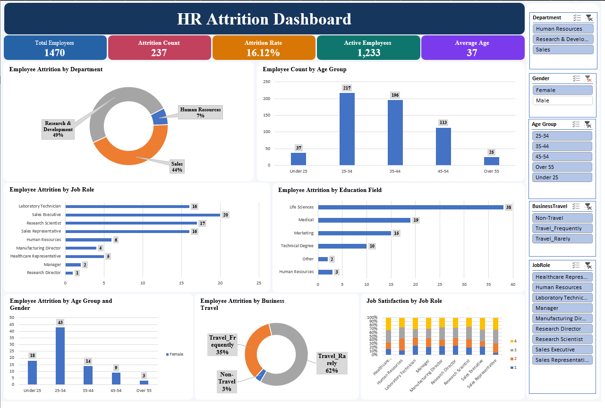

# HR Attrition Dashboard | Excel

## Project Overview
An interactive HR Analytics dashboard created entirely in Microsoft Excel to analyze employee attrition and workforce trends. The dashboard uses PivotTables, PivotCharts, KPI cards, and slicers to explore employee data.

## Dashboard Preview


## Dataset
- **Source:** Kaggle
- **Dataset:** IBM HR Analytics Employee Attrition & Performance
- **File:** `WA_Fn-UseC_-HR-Employee-Attrition.csv`
- **Format:** CSV
- **Records:** 1,470 employees
- **Features:** Department, Job Role, Age, Gender, Education Field, Business Travel, Job Satisfaction, and Attrition.

## Key Performance Indicators (KPIs)

| KPI | Value |
|---|---:|
| Total Employees | 1,470 |
| Attrition Count | 237 |
| Attrition Rate | 16.12% |
| Active Employees | 1,233 |
| Average Age | 37 |

## Dashboard Features
- Employee attrition by department
- Employee count by age group
- Attrition by job role
- Attrition by education field
- Attrition by age group and gender
- Attrition by business travel
- Job satisfaction by job role
- Interactive slicers for department, gender, age group, business travel, and job role

## Tools & Techniques
- Microsoft Excel
- PivotTables and PivotCharts
- Slicers
- KPI cards
- Data analysis and visualization

## Key Insights
- The overall employee attrition rate is 16.12%.
- Research & Development has the highest attrition count among departments.
- Employees aged 25–34 represent the largest age group in the dataset.
- Laboratory Technicians and Sales Executives have the highest attrition counts among job roles.

## Project Structure
```text
HR-Attrition-Dashboard/
├── Dashboard/
│   └── HR_Attrition_Dashboard.xlsx
├── Data/
│   └── WA_Fn-UseC_-HR-Employee-Attrition.csv
├── Image/
│   └── dashboard-preview.png
└── README.md
```

## How to Use
1. Clone or download this repository.
2. Open `Dashboard/HR_Attrition_Dashboard.xlsx` in Microsoft Excel.
3. Use the slicers to explore employee attrition across different categories.

## Disclaimer
This project is for educational and portfolio purposes. The dataset is publicly available on Kaggle and does not represent actual organizational HR records.

## Author
Prakash Jha
